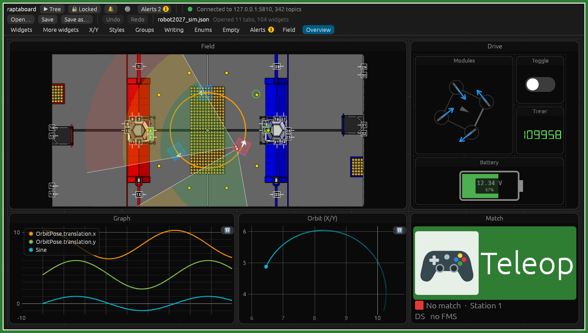

# raptaboard

An FRC driver dashboard written in Rust, from FRC Team 3200 (Raptacon). It started from
[Elastic](https://github.com/Gold872/elastic-dashboard) and aims past it: everything Elastic does,
a richer set of widget settings, and **widget plugins**: small WebAssembly programs that load
without rebuilding the dashboard and draw a NetworkTables table, such as an arm subsystem, or fill
a whole tab.

Status: **0.4.0**, with widget plugins and content packs (see [CHANGELOG.md](CHANGELOG.md)). It
opens and saves Elastic layouts, connects to the robot over NetworkTables (by team number, the
Driver Station, SystemCore or the sim), shows a live tree of every topic, and has most of Elastic's
widgets, a Field widget with layers, and Alerts with a history.

**Documentation: [tuffinmuffin.github.io/raptaboard](https://tuffinmuffin.github.io/raptaboard/)**:
using raptaboard, developing it, and writing plugins. Its source is in [`book/`](book/src/SUMMARY.md).

## Highlights

- **Elastic layouts open**, and raptaboard saves files Elastic can open again.
- **The Field** with layers: other robots, paths, the AprilTags your cameras see, game pieces, and
  cameras' views and parts riding on the robot.
- **Arranging that keeps out of your way**: widgets slide aside to make room as you drag, hold Alt
  to overlap them, and **Fill space**, **Pack widgets** and **Pin in place** tidy up.
- **Groups and List Layouts** hold widgets together, and can set every widget's text and update
  rate at once.
- **Graphs that look back**: pause and scroll back up to ten minutes, statistics between
  cursors, X/Y and Polar Graphs.
- **Text styles**: Sans, Mono, Serif, Narrow or a seven-segment Digital font, bold, italic, any
  color.
- **The robot's state** on the window's border, a sound for each change, and alerts with a history.
- **Plugins and content packs**: widgets and whole tabs as WebAssembly plugins, sounds and more,
  downloaded only when you choose.

See [the book](https://tuffinmuffin.github.io/raptaboard/) for all of it.

## Install

**Windows: the [Microsoft Store](https://apps.microsoft.com/detail/9N5CLXQLBQNF)** is the easiest:
signed, no "Windows protected your PC" prompt, and it updates itself. Store updates can come a
little after a GitHub release, and the Store version doesn't include `raptaboard-cli`; for those,
use the files below.

Or download the file for your computer from the
[latest release](https://github.com/tuffinmuffin/raptaboard/releases/latest):

| System | File |
| --- | --- |
| Windows, installed (Start menu, uninstaller; no admin needed) | `raptaboard-<version>-windows-x64-setup.exe` |
| Windows, portable (unzip and run; settings stay in its folder) | `raptaboard-<version>-windows-x64.zip` |
| macOS 11+, Apple Silicon and Intel | `raptaboard-<version>-macos-universal.zip` |
| Linux x64 (`./install.sh` adds it to your menu, for you only) | `raptaboard-<version>-linux-x64.tar.gz` |

These builds aren't signed yet, so the first start asks first. **Windows:** at "Windows protected
your PC", click "More info", then "Run anyway". **macOS:** right-click raptaboard.app, choose
Open, then Open again. Each package has a README.txt with first steps.

## Building from source

With [Rust](https://rustup.rs) installed: `cargo run -p raptaboard` and `cargo test --workspace`.
See [Building from source](https://tuffinmuffin.github.io/raptaboard/dev/building.html) for the
options, Linux's libraries and building the book.

## Contributing

Work happens on branches with pull requests into `main`; see
[Contributing](https://tuffinmuffin.github.io/raptaboard/dev/contributing.html).

## License

MIT, see `LICENSE`. raptaboard includes sounds, images and fields from others and is built from
open-source crates: see [License](https://tuffinmuffin.github.io/raptaboard/license.html).
