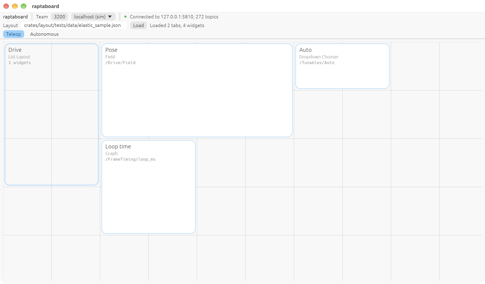

# raptaboard

An FRC driver dashboard written in Rust, from FRC Team 3200 (Raptacon). The goal is to do everything
[Elastic](https://github.com/Gold872/elastic-dashboard) does, open Elastic layouts as they are, and
add **widget plugins**: small WebAssembly modules that load without rebuilding the dashboard and draw
a NetworkTables table, such as an arm subsystem.

Status: **milestone 1 in progress.** The app opens an Elastic layout and shows its tabs and widget
boxes on the grid, and connects to the robot over NetworkTables (status and topic count in the
settings bar) with a NetworkTables tree of live values, including WPILib structs such as Pose2d. Widgets don't show live values yet.



## Quick start

Install Rust with [rustup](https://rustup.rs) (stable, 1.95 or newer), then:

```sh
cargo run -p raptaboard -- crates/layout/tests/data/elastic_sample.json
cargo test --workspace
```

To connect to robot code running in simulation on this computer, add `--address sim`. Use
`--team N` for another team's robot and `--help` for every option.

On Linux you also need the windowing libraries:
`sudo apt install libxkbcommon-x11-0 libxcb-render0-dev libxcb-shape0-dev libxcb-xfixes0-dev libxkbcommon-dev`.

## Repo layout

| Path | What it is |
| --- | --- |
| `crates/layout` | Layout model; reads and writes Elastic `version 1.0` JSON without losing fields |
| `crates/plugin-host` | Plugin manifests (`plugin.toml`), matching plugins to NT tables, topic path helpers |
| `crates/app` | The eframe/egui desktop app (binary `raptaboard`) |
| `wit/dashboard.wit` | The plugin interface: what a WASM widget imports and exports |
| `plugins/arm` | Example plugin manifest for an arm table tagged `.type = "Arm"` |
| `docs/spec.md` | The spec: Elastic feature list, requirements, plugin design, milestones |

NetworkTables comes from the [`nt4`](https://crates.io/crates/nt4) crate: client, typed topics,
structs, time sync and reconnect.

## Writing a plugin (preview)

A plugin is a folder with `plugin.toml` and `widget.wasm`. The manifest says which tables it can
draw:

```toml
name = "arm"
version = "0.1.0"
api = "0.1"

[match]
type = "Arm"        # the table's .type topic
```

The WASM module implements the `widget` world from `wit/dashboard.wit`: it reads values with
`get("angle_rad")` and returns shapes to draw. Running plugins arrives in milestone 4.

## Contributing

Work happens on branches with pull requests into `main`. CI runs `cargo fmt --check`,
`cargo clippy -D warnings` and `cargo test` on Linux, Windows and macOS. Read `CLAUDE.md` if you are
using Claude Code; it has the same rules.

## License

MIT, see `LICENSE`.
