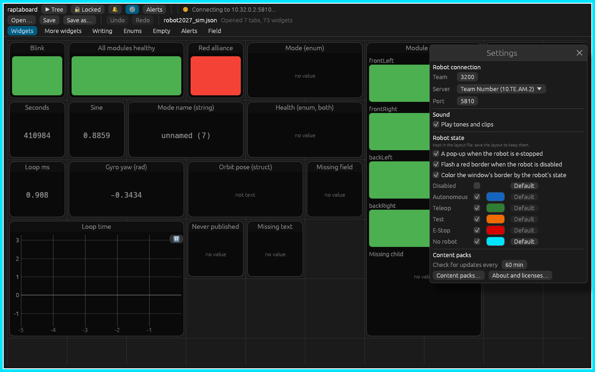

# Connecting to the robot

raptaboard talks to the robot over NetworkTables 4, as a client: the robot code (or the
simulator) runs the server, on port 5810.

Open **⚙ Settings** in the top bar. Under **Robot connection**:



- **Team**: your FRC team number.
- **Server**: how to find the robot (below).
- **Port**: 5810, robot code's NetworkTables port. Change it only for a server on another port.

The changes take effect at once and are saved.

## Where the robot is

| Server | Connects to | When |
| --- | --- | --- |
| Team Number (10.TE.AM.2) | `10.TE.AM.2`: team 3200 is `10.32.0.2` | A roboRIO on the robot's network, at home or on the field. The default. |
| SystemCore mDNS | `robot.local` | A SystemCore on the robot's network. |
| SystemCore WiFi | `172.30.0.1` | Joined to a SystemCore's own WiFi. |
| localhost (sim) | `127.0.0.1` | Robot code in simulation on this computer. |
| Custom | the address you type | Anything else: a host name or IP address. |
| Driver Station | asks the Driver Station | **Not finished yet**: it shows "Waiting for Driver Station" and never connects. Use Team Number. |

## The status

The top bar shows how the connection is going, with a colored dot:

- ⚪ **Set a team number**: the Server is Team Number, and there's no team.
- 🟠 **Connecting to 10.32.0.2:5810…**: trying. It keeps trying, and reconnects by itself if the
  robot reboots or the radio drops.
- 🟢 **Connected to 10.32.0.2:5810, 342 topics**: connected, with how many topics the server has.

If it stays on Connecting: check the team number, that this computer is on the robot's network
(its WiFi or Ethernet), and that robot code is running. A firewall can block port 5810.

The window's border can show the robot's state too: cyan with no robot, green in teleop, and so
on, set under **Robot state** in the same window. See [The window](window.md).

## From the command line

The same choices, for one run, without changing the saved settings:

```sh
raptaboard --team 3200                 # by team number
raptaboard --address sim               # the simulator on this computer
raptaboard --address mdns              # SystemCore by mDNS (wifi: its WiFi)
raptaboard --address 10.0.0.5 --port 5811
```

`--address` takes `team`, `mdns`, `wifi`, `sim`, `ds`, or a host name or IP. In `settings.toml`
they're `team = 3200`, `address = "team"` and `port = 5810`.
