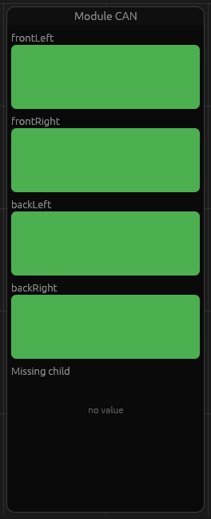

# Layouts

A layout is everything on the grid: its tabs, the widgets on each, the lists and Groups that hold
widgets together, and where all of it sits. It also keeps the window border's robot-state colors
(see [The window](window.md#the-robots-state)). One layout is open at a time, and it's saved as a
file you can keep, copy and share.

## Layout files

**Open…** (Ctrl+O), **Save** (Ctrl+S) and **Save as…** (Ctrl+Shift+S) are in the file bar. The
layout's name there gets a dot while it has unsaved changes, and raptaboard asks whether to save
them before opening another layout or quitting.

raptaboard reopens the layout you last opened or saved, on the tab you were on. The very first
time there's none: an empty **Untitled** layout with two tabs, and **Save** asks where to put it.

A layout can also be named when starting raptaboard, for one run:

```sh
raptaboard layouts/practice.json
```

If the file doesn't exist yet, raptaboard starts with an empty layout and **Save** writes it there.
A file that's missing or isn't a layout gets a window offering **Open a layout…**, **New layout
saved here** (for a missing one) or **Close**.

Saving replaces the file in one step, so a crash or a power cut never leaves half a file. Layouts
are ordinary files: keep the team's in the robot code's repository, and copy them to each Driver
Station laptop.

## Elastic layouts

raptaboard opens Elastic's layout files, and saves files Elastic can open again. Widgets with the
same names work the same way. What raptaboard adds, Elastic doesn't know: its own widgets (Battery,
Chassis Speeds, 3D Pose, Struct, X/Y Graph, Polar Graph), Groups, and raptaboard's extra settings,
which Elastic ignores. The other way round, an Elastic widget raptaboard doesn't have shows as a
card with its type and topic, and keeps its settings.

The grid's size comes from the file: Elastic's 128 pixels a cell unless it set another.

If a file has places or sizes raptaboard can't use, such as a widget of zero size or two on top of
each other, raptaboard fixes them as it opens the file and the file bar says **⚠ fixed N
problems**; see [Troubleshooting](troubleshooting.md#layouts).

## Tabs

Each tab is a page of widgets: add, rename, move and close them as [The window](window.md#tabs)
describes. A tab whose name is a tab plugin's, with nothing on it, shows that plugin (see
[Content packs and plugins](content-packs.md#tab-plugins)).

## Arranging widgets

Unlock the layout first (**🔒 Locked** in the settings bar).

- **Move** a widget by dragging it; it snaps to the grid. Widgets in the way slide aside to the
  nearest free spots, shown as you drag; move on and they slide back. The outline is red only when
  one of them has nowhere to go. **Escape** calls the drag off, leaving everything as it was.
- **Resize** it by dragging its bottom-right corner. Growing over others pushes them aside too.
- **Overlap** others by holding **Alt** (Option on a Mac) while you drag or resize: it goes partly
  *over* them, in front, instead of pushing them aside, such as a label on a corner of a camera
  view. No widget may be hidden completely, so the outline turns red where it would hide one.
  With Alt held, nothing goes into a list or Group: it goes over it. The same works for topics
  dragged from the tree and widgets dragged out of a list or Group. A widget, list or Group
  overlapping another has **Bring to front** and **Send to back** in its right-click menu.

### Tidying up

- **Fill space** (a widget's right-click menu): the widget grows into the empty cells around it,
  taking the biggest space it can without covering anything, within what shows in the window.
- **Pack widgets** (right-click empty grid): every widget slides up, then left, as far as it can,
  closing the gaps. Sizes and the order stay the same.
- **Pin in place** (a widget's right-click menu, or its settings): a pinned widget is never pushed
  aside by another or moved by Pack widgets; a drop that would push it is refused. You can still
  drag it yourself. While the layout is unlocked, a pin shows in its top-left corner.

Each is one **Undo** away.

## Lists



A **List Layout** is a card that stacks widgets top to bottom, without a card each: a label with
each one's title, and its value. It packs many values into a small space, such as every module's
CAN status. Make one with **Put in a new list** on a widget's right-click menu, then drag widgets
into it or use **Add to list** in the tree. Its settings set where the labels go and whether there
are dividers between rows; double-click a row for that widget's own settings. Graphs in a list
show their newest value as text.

Like a Group's, a list's settings have **Widgets inside**, off until **Apply to the widgets
inside** is ticked: an **Update period** and **Text** for every widget in it (see
[Groups](#groups)), and **Labels**, the size, font, color, bold and italic of the labels. The
labels' size is the list's, so the rows stay even.

## Groups


A **Group** is a card with a small grid of its own, so widgets inside can sit side by side and be
any size: a drive panel, say, with speeds, a gyro and a few lights in one card. Everything inside
is drawn as a shrunk copy, text too, so resizing the Group grows or shrinks what's in it.

- **Make one** with right-click on empty grid → **New Group**, or **Put in a new group** on a
  widget's right-click menu (the Group takes its place, with the widget in it).
- **Put widgets in** by dragging them onto it, or dropping topics on it from the tree: each goes in
  the cell under the pointer, pushing what's there aside. **Add to group** on a topic's
  right-click menu in the tree puts it in the Group's first free cell, or in a new Group. With **Alt** held they go over the
  Group instead, as over a list, and a Group can be placed over other widgets the same way.
- **Arrange them** (unlocked) as on the grid: drag a widget to move it, drag its corner to resize
  it. Drag it out of the Group onto the grid, or into a list or another Group.

  

- **Right-click** a widget inside for **Edit…**, **Edit group…** and **Remove from group**;
  double-click it for its settings.
- Its cells are square. **Rows** (in its settings, 2 unless set) sets how tall they are: the
  Group's height divided by the rows. As many columns as fit go across, so a wider Group has
  more columns, and a taller one bigger cells. The cells show as faint lines; **Grid lines** in
  its settings hides them.

  

  To leave no space at the right, choose Rows to suit the Group's shape: the settings show the
  columns and rows it gives. The Drive panel above is 6 cells by 5 on the tab, and 4 rows gives
  5 columns that fill it.

Under **Widgets inside**, a Group can set the **Update period**, **Text** (size and style) and
**Title text** for every widget in it, so a panel looks alike without editing each one. Tick
**Apply to the widgets inside** to turn this on (it's off for a new Group). While it's on, the
Group decides all of these for its widgets: what its rows set, and the usual for anything they
leave alone, in place of each widget's own. A widget's settings say what its Group sets, and
those rows are greyed out. Untick it and every widget has its own settings again; the Group's
are kept for later.

To set up one widget on its own while the rest follow the Group, untick **Use the shared
settings** in that widget's settings: it then uses the settings it had.

Locked, the widgets inside work as they do on the grid: toggles toggle, sliders slide.
