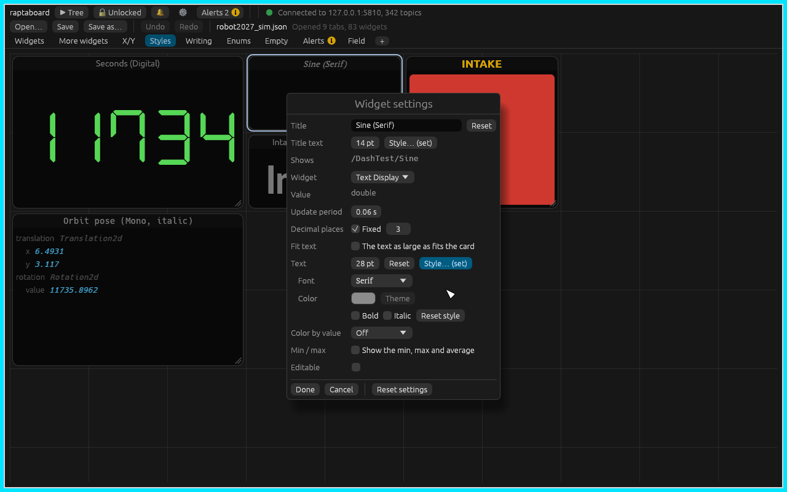
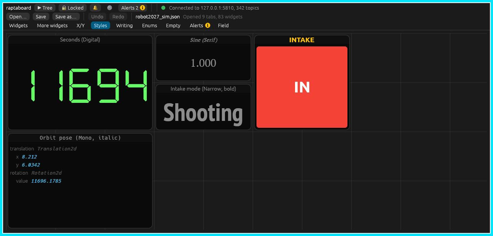

# Widgets

A widget shows one topic from the robot: a number as text or a gauge, a boolean as a colored box, a
pose on the field. Some also send values back, such as toggles, sliders and choosers. This chapter
covers what all widgets share. The pages after it go through each kind:

- [Text and numbers](widgets/text-and-numbers.md): Text Display, Number Bar, Voltage View, Radial
  Gauge, Battery, Number Slider, Match Time
- [Booleans and choices](widgets/booleans-and-choices.md): Boolean Box, Toggle Switch and Button,
  Dropdown and Split Button Chooser, Enum Dropdown and Toggle, Single and Multi Color View
- [Graphs](widgets/graphs.md): Graph, X/Y Graph, Polar Graph
- [The robot and the field](widgets/robot.md): Field, Gyro, Swerve Drive, Chassis Speeds, 3D Pose,
  Mechanism2d, Struct
- [Match and alerts](widgets/match-and-alerts.md): FMSInfo, Alerts

Widgets with the same names as Elastic's work the same way and are saved the same way, so Elastic
layouts open in raptaboard. raptaboard adds its own settings (Elastic ignores them) and some widgets
of its own: Battery, Chassis Speeds, 3D Pose, Struct, X/Y Graph and Polar Graph.

## Adding a widget

Unlock the layout first (**🔒 Locked** in the settings bar). Then, from the NetworkTables tree:

- **Drag a topic onto the grid.** It becomes the usual widget for its type: a Boolean Box for a
  boolean, a Text Display for a number or text, a Struct for a struct. Drag a table, such as a
  SendableChooser, a Mechanism2d or the Driver Station's, and it becomes the widget made for that
  table. Drag one field of a struct, such as a pose's `x`, to show just that field. Dropped on a
  widget, the new one takes its place and pushes it aside (except onto a widget that takes topics,
  below).
- **Right-click a topic** for **Add to grid** (the same as dragging it), **Add as**, which lists
  every widget that can show it (a number can be a Text Display, a Number Bar, a Graph and more),
  and **Add to list** to add it to a List Layout.
- **Drop a topic onto a widget** that takes more than one: a Graph adds it as a line, an X/Y or
  Polar Graph as the next value of a pair, a Field as a layer. A Swerve Drive or Chassis Speeds
  takes requested speeds and a heading this way.

Select several topics in the tree (Ctrl-click or Shift-click) and drag them together to add them
all.

## Changing widgets

Unlocked (moving, resizing and arranging widgets are in [Layouts](layouts.md)):

- **Click** it to select it. That also finds its topic in the tree.
- **Double-click** it, or press **Enter** while it's selected, to open its settings.
- **Right-click** it for **Edit…**, **Duplicate** (Ctrl+D), **Delete** (Delete), **Put in a
  new list**, and **Fill space** and **Pin in place** ([Layouts](layouts.md#tidying-up)). A
  widget that keeps a min and max or a scale from the values it has seen also has **Reset
  min/max** or **Reset scale**.

Every change can be undone with **Undo** (Ctrl+Z). Locked, nothing moves, but widgets that send
values (toggles, sliders, choosers, typing into a Text Display) still work.

## The settings dialog

Every widget's settings start with the same rows:

| Row | What it does |
| --- | --- |
| **Title** | The name in the card's title bar. **Reset** puts back the name from the topic. |
| **Title text** | The title's size, and **Style…** for its font, color, bold and italic. |
| **Shows** | The topic (and struct field) it shows. |
| **Widget** | The kind of widget. Pick another to change it, such as a Text Display into a Graph. Only widgets that can show the topic are listed. |
| **Value** | The topic's type, such as `double` or `struct:Pose2d`. |
| **Update period** | How often the widget gets new values, in seconds: 0.06 (about 16 a second) unless set; graphs default to about 60 a second. |

The rows after that are the widget's own, described on each widget's page. Changes show on the
grid right away. **Done** keeps them, **Cancel** puts everything back as it was, and **Reset
settings** puts the widget's own settings back to their defaults (it keeps the title and what it
shows).

## Text style

The title of every widget, and the value text of a Text Display, Boolean Box and Struct, can be
styled. **Title text** and **Text** each have a size and a **Style…** button that opens these rows
under it:

- **Font**: Sans (the usual), Mono (every letter the same width, so numbers don't jump about), Serif,
  Narrow (fits more in a small card) or Digital (a seven-segment display, for timers and scores).
  Each name in the list is drawn in its own font. Digital has digits and a few letters; anything
  else falls back to Sans.
- **Color**: any color, or **Theme** to follow the theme's text color.
- **Bold** and **Italic**.
- **Reset style** puts the font, color, bold and italic back.

The button reads **Style… (set)** while anything is changed from the widget's usual style. Click
**Style…** again to hide the rows.

The fonts are part of raptaboard, so a layout looks the same on every computer.
