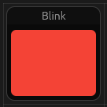
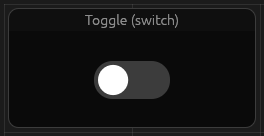
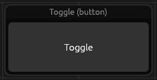
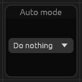
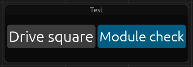
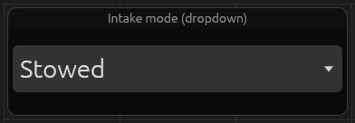
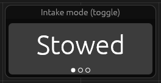
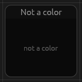

# Booleans and choices

## Boolean Box

Fills with one color when the boolean is true and another when it's false (green and red unless
set). It's the usual widget for a boolean dragged from the tree.

| Setting | What it does |
| --- | --- |
| **When true**, **When false** | The color for each state. **Clear** makes it see-through. |
| **Picture when true**, **Picture when false** | Nothing, a built-in icon (Checkmark, X, Exclamation Point), or an image of your own, drawn over the color. **Import…** adds a PNG, JPEG or SVG to your images folder. |
| **Text** | **Write text over the color**: **Text when true** and **Text when false**, their colors (black or white, whichever reads, unless set), and **Text backing**, a see-through box behind the text so it reads over any color. |
| **Text** (size) | The text's size and [style](../widgets.md#text-style): font, bold and italic. |

Your images are kept in `~/.raptaboard/images/` and found by name, so another computer needs the
same image there to show it.

## Toggle Switch and Toggle Button

Show a boolean and flip it when clicked, sending the opposite value to the robot. Locked, a click
anywhere on the card toggles it; unlocked, a click below the title bar does. With no value yet they
show off, and a click sends `true`. They have no settings of their own.

## Dropdown Chooser and Split Button Chooser

Pick one of a SendableChooser's options, such as the auto routine, and send it to the robot. Drag
the chooser's table from the tree (under `SmartDashboard`) to make a Dropdown Chooser; **Add as**
offers the Split Button Chooser, a row of buttons with one per option.

What's shown as picked is the dashboard's pick if it's one of the options, else the one the robot
is using, else the chooser's default. While the robot hasn't taken the pick yet, the widget says
what the robot has. **Text size** sets the text's size; unset, it fits the card.

## Enum Dropdown and Enum Toggle

For a topic that holds one of a few named states, such as an intake's mode or an arm's level,
shown by name and changed from the dashboard. The topic is a string or whole-number topic that the
robot publishes and reads back; the newest value wins, from the robot or any dashboard. The Enum
Dropdown lists the states; the Enum Toggle is one button with the state's name that steps to the
next state on each click.

| Setting | What it does |
| --- | --- |
| **Names from** | Where the states' names come from: a **list** in the settings, a string array **topic** the robot publishes, or a SendableChooser. raptaboard guesses when the widget is made, and **Guess again** does it over. |
| **States** | The list, one per line. For a whole-number topic, `3 = Climb`, or just `Climb` for the number after the line before (counting from 0). |
| **Names topic** | The string array topic, when names come from one. |
| **Switches between** | Enum Toggle only: two states a click goes between, like a Toggle Button's off and on. Left empty, each click steps to the next state. |
| **Editable** | Off, the widget only shows the state. |

A value that isn't a listed state shows as `unnamed (7)` (or its text), with nothing picked.

## Single Color View and Multi Color View

A color sent as hex text: Single Color View fills with one color from a string such as `#FF8800`
(or `#80FF8800`, with see-through); Multi Color View takes a string array and blends its colors
left to right, for an LED strip. Neither has settings.
