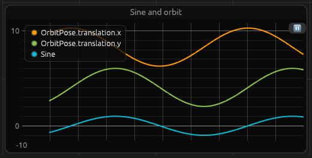
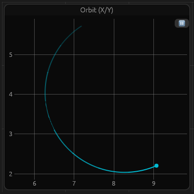
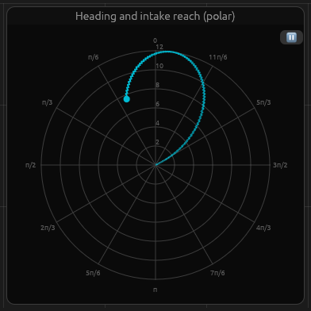

# Graphs

## Graph

Numbers over time. One graph can show several lines, so values to compare sit on one plot. Make
one with **Add as** → Graph on a number or boolean (booleans plot as 0 and 1), then drop more
topics onto it from the tree to add lines. A legend shows when there's more than one.

**Pause and measure.** The **⏸** button freezes the picture while values keep being recorded.
While paused:

- **Click** the plot to place cursor A, and again for B. The readout gives the time between them
  and each line's value at both. With both placed, any click clears them.
- **Drag** along the plot, or use the **mouse wheel**, to look back through everything recorded.
- **Ctrl** (⌘ on a Mac) with the wheel zooms in and out.

**▶** goes back to live.

| Setting | What it does |
| --- | --- |
| **Time shown (s)** | How many seconds of history fit across the graph (5). |
| **History kept (s)** | How far back you can look while paused (60, up to 600). |
| **Range** | **Fixed** sets the y axis' range; off, it fits the values. |
| **Line width** | How thick the lines are. |
| **Legend** | Show the legend (on when there's more than one line). |
| **Pause** | Show the pause button. |
| **Hover** | Show each line's value where the pointer is. |
| **Min / max** | Each line's lowest, highest and average values, over the time shown or between the cursors. |
| **Lines** | Each line's color and name, ↑ and ↓ to reorder them, and **Remove**. The first is the main line, which Elastic also shows. |

## X/Y Graph and Polar Graph

Plot one value against another, both recorded at the same time. An **X/Y Graph** plots x against
y: a joystick's position, a robot's path, commanded against measured speeds. A **Polar Graph**
plots a distance at an angle: a turret's aim and range. raptaboard's own; Elastic doesn't have them.

Each **pair** draws a trail of its last few seconds, fading as it ages, with a dot at the newest
point. A graph can show several pairs, each in its own color. When the two values arrive at
different times, each one keeps its last value until the other changes.

**Making one:**

- **Add as** → X/Y Graph on a Translation2d, Translation3d, Pose2d, Pose3d or ChassisSpeeds topic
  plots its x and y (a ChassisSpeeds' vx and vy) at once.
- **Add as** → X/Y Graph or Polar Graph on a number gives the first value (x, or the angle). The
  card asks for the second: drop another number onto it from the tree (y, or the distance).
- Dropping more topics onto a graph adds pairs the same way.

A Rotation2d works as a number, its angle in radians: a Polar Graph made for one is set to
radians.

| Setting | What it does |
| --- | --- |
| **Trail (s)** | How many seconds of trail (3). 0 shows only the newest point. |
| **X range**, **Y range** | X/Y only: **Fixed** sets each axis' range; off, they fit the values. |
| **Same scale** | X/Y only: a unit as long across as up, for places on the floor. |
| **Distance** | Polar only: **Fixed** sets the outer ring's distance; off, it fits the values. |
| **Angle in** | Polar only: degrees or radians. Spokes are labelled in the same unit. |
| **Zero points** | Polar only: where angle 0 is: right, up, left or down. |
| **Clockwise** | Polar only: angles grow clockwise (off: anticlockwise, as WPILib counts). For a compass or a turret, set Zero points to up and turn this on. |
| **Line width**, **Legend**, **Pause**, **Hover** | As on a Graph. Hovering shows where the pointer is and each pair's newest values. |
| **Pairs** | Each pair's color and **Remove**. Hover a pair's name to see its topics. |

The pause button freezes the picture, as on a Graph; X/Y and Polar Graphs don't have the
measuring cursors or looking back.
