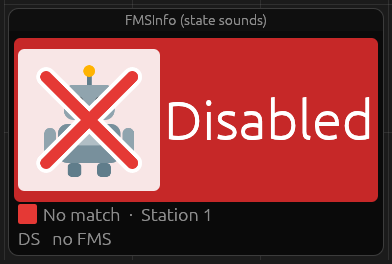
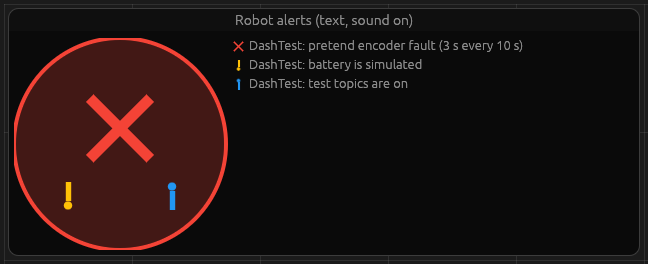

# Match and alerts

## FMSInfo

The Driver Station's view of the robot and the match: the robot's state large, with an icon and
in its own color (Disabled, Autonomous, Teleop, Test, E-Stop or No robot); the alliance color; the
match, station and event; and whether the DS and FMS are attached. Drag the Driver Station's table
from the tree to make one: `/DriverStation` (WPILib 2027) or `/FMSInfo` (2026).

Each part (robot state, state icon, alliance color, match, station, replay, event name, game data,
DS and FMS) can be shown or hidden in the settings; replay and game data are hidden unless turned
on.

**Sounds.** FMSInfo can play a sound when the robot's state changes: disabled, autonomous, teleop
or test starting, e-stopped, the robot connecting again or being lost, and the Driver Station or
FMS leaving.
Each one is off, a built-in tone, a sound from a content pack, or an MP3 or WAV file
(**File…**), with **Play it** to hear it; **Volume** sets how loud. Only the first FMSInfo in the
layout plays them, from any tab, and only when the state really changes (not for the state found
on connecting). The 🔔 button in the settings bar mutes them.

## Alerts

The robot's active alerts, from WPILib's `Alert` class: a circle with a red ✕ for errors, a yellow
! for warnings and a blue i for infos. Each sign lights while there's an alert of its level, with
a count when there's more than one, and the most urgent grows large in the middle. Small, it's a
status light; big, it lists the alerts' text too. Drag an alert group's table from the tree to
make one.

| Setting | What it does |
| --- | --- |
| **Groups** | **Every alert group on the server**, instead of just this one. |
| **Text** | **List the alerts' text**, errors first and each level newest first. **Text goes** beside or below the circle. |
| **Show down to** | The least urgent level listed: error, warning or info. |
| **Pulse** | **Pulse when a new error arrives**, for **Pulse for (s)** seconds or until no error is active. |
| **Sound** | Play a tone when a new error arrives; **Tone** picks which. The 🔔 button mutes it. |

While the robot is disconnected the widget keeps showing the last alerts it saw, greyed, so what
was wrong just before isn't lost. The **Alerts** button in the settings bar shows every alert since
connecting.
