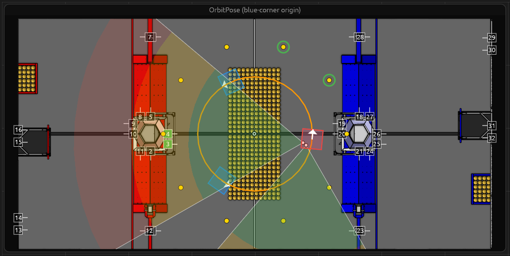
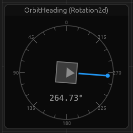
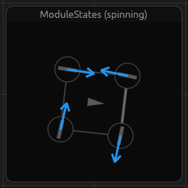
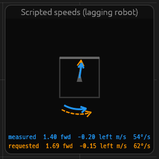
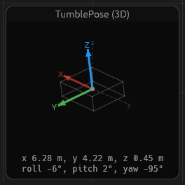
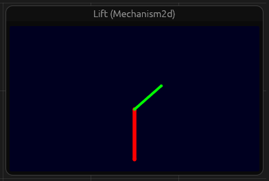
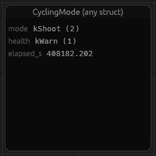

# The robot and the field

These widgets read WPILib structs, such as a `Pose2d` or `SwerveModuleState[]`. raptaboard decodes
them with the schemas the robot publishes, so any struct works, including your team's own.

## Field

The robot on a top-down view of the field. Make one with **Add as** → Field on a `Pose2d` or
`Pose3d` topic (an array of them is the robot and others), or drag a WPILib `Field2d` table from
the tree.

| Setting | What it does |
| --- | --- |
| **Field** | Which field: 2026 REBUILT is built in, and **Open field file…** opens a WPILib field JSON. |
| **Poses' origin** | Where (0, 0) is: the field's center (WPILib 2027) or the blue alliance's corner (before 2027). |
| **View** | Turn the field: 0, 90, 180 or 270 degrees. 180 is the view from the red side. |
| **Robot length (m)**, **Robot width (m)**, **Robot color** | How the robot is drawn. |
| **AprilTags** | Show the field's AprilTags. Tags a camera layer sees light up. |
| **Other objects**, **Trajectories** | A `Field2d` table's other objects, as robots, or as paths when they have many poses or "traj" or "path" in their name. |
| **Click to set a target** | A click on the field publishes a target pose there (**Target topic**); drag to set which way it faces, right-click to clear it. The robot code reads it. |
| **Cameras** | **Add camera**: a camera's field of view on the robot, with range bands (**Bands to (m)**). |
| **Parts** | **Add part**: a part of the robot, such as an intake, **Shown while** a boolean topic is true, or with its **length from** a number topic. |
| **Layers** | **Add layer**: other robots, paths and game pieces from their own topics, drawn as circles, rings, X's or squares of a set **Size (m)**, on the field or **Relative to the robot** (as a camera reports what it sees). Dropping a topic onto the field adds one. |

## Gyro

Which way the robot faces, on a compass dial with 0° straight up, a robot outline, a needle, and the
angle below. Make one with **Add as** → Gyro on a `Rotation2d` topic, a `Rotation3d` (its yaw), a
number of degrees, or a WPILib `Gyro` table. Rotations count counterclockwise, as WPILib does; for
numbers and Gyro tables, **Counterclockwise** says which way they count (off unless set, as most
gyros' `getAngle` counts clockwise).

## Swerve Drive

The robot from above with its four modules, each wheel turned the way it points and an arrow for
its speed. Make one with **Add as** → SwerveDrive on a `SwerveModuleState[]` topic, the measured
states, or drag Elastic's `SwerveDrive` table.

| Setting | What it does |
| --- | --- |
| **Requested states** | The states asked for, drawn as dashed arrows against the measured ones. |
| **Heading** | Turns the robot the way it faces: a rotation, a pose, or degrees counterclockwise. |
| **Turn with heading** | Off, the front is always up. |
| **Robot speeds**, **Requested speeds** | `ChassisSpeeds` topics: the whole robot's motion, an arrow from its center and an arc for its spin (requested ones dashed). |
| **Full arrow (m/s)** | The speed of a full-length arrow. |
| **Angles in** | For Elastic's table: degrees or radians. |

Dropping topics from the tree onto it fills these in: states set the requested states, chassis
speeds the robot's speeds (measured first, then requested), and a rotation or pose the heading.

## Chassis Speeds

How the robot is moving, drawn on the robot from above: an arrow for its velocity and a curved
arrow round it for its spin. Make one with **Add as** → Chassis Speeds on a `ChassisSpeeds` topic
(robot-relative, as measured speeds are). The numbers are written below when the card has room.
**Requested speeds** draws the speeds asked for, dashed against the measured ones; **Heading**,
**Full arrow (m/s)** and dropping topics on it work as on a Swerve Drive. raptaboard's own.

## 3D Pose

Which way something is turned in 3D: X, Y and Z arrows (red, green, blue) and a box that turn with
it, over faint fixed axes, with its position and its roll, pitch and yaw below. For a `Pose3d`,
`Transform3d`, `Rotation3d` or `Quaternion` topic, or a `Pose2d`, flat: **Add as** → 3D Pose. Drag the card to look from another side; double-click to look from the usual
corner again. raptaboard's own.

## Mechanism2d

WPILib's `Mechanism2d` drawing of an arm, elevator or other mechanism, as robot code publishes it.
Drag its table from the tree (under `SmartDashboard`) to make one. **Fit** zooms to the part of the
canvas the mechanism has used (double-click to start over), or shows the whole canvas.

## Struct

Any struct, or array of them, as a list of its fields, the way the tree shows them: nested structs
indented, arrays as `[0]`, `[1]`, ..., and enum fields by name. It's the usual widget for a struct
dragged from the tree. The values' text can be [styled](../widgets.md#text-style) (Mono unless
set). raptaboard's own.
