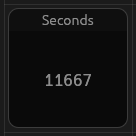
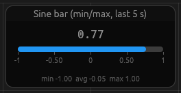
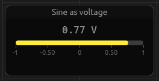
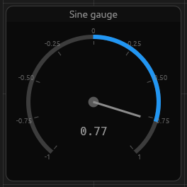
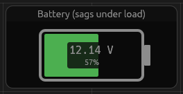
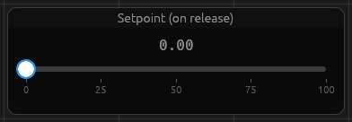
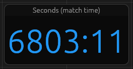

# Text and numbers

## Text Display

Shows any value as text: a number, a string, a boolean, an array, or one field of a struct. It's
the usual widget for a number or a string dragged from the tree. Elastic's Text View and Large Text
Display open as Text Displays.

| Setting | What it does |
| --- | --- |
| **Decimal places** | **Fixed** writes numbers with this many decimal places; off, as many as they need. |
| **Whole numbers** | For whole-number topics: decimal, hex or binary, with **Digits** to pad them (`0x00FF`). |
| **Enum shows** | For an enum field of a struct: its name, its number, or both. |
| **Fit text** | The text as large as fits the card (Elastic's Large Text Display). |
| **Text** | The text's size (when not fitted) and its [style](../widgets.md#text-style): font (Mono unless set), color, bold, italic. |
| **Color by value** | Colors the card by the number: thresholds (red below one value, yellow between, green above, or your own colors) or a gradient between them. |
| **Min / max** | Writes the lowest, highest and average values under the number, over the last few seconds or since the last reset (right-click → **Reset min/max**). Every value received counts, not just the ones shown, so short peaks show. |
| **Editable** | Lets you type a value to send to the robot. |

**Typing a value.** An editable Text Display has a blue dot in its corner. Click it (locked, the
whole card; unlocked, below the title bar) to open a box with the value selected, type, and press
**Enter** to send it. Text that isn't a number for a number topic, or `true`/`false` for a boolean,
turns red and isn't sent. Escape closes the box without sending. Arrays and struct fields can't be
typed in.

## Number Bar and Voltage View

A number as a bar filled from the minimum, with the value above it and labels along it. A dot past
an end shows the value is beyond the bar. Voltage View is the same widget set up for volts (4 to
13 V, yellow); it's kept so Elastic layouts open.

| Setting | What it does |
| --- | --- |
| **Minimum**, **Maximum** | The bar's range (-1 to 1 for a Number Bar). |
| **Autoscale** | Instead of a set range, follow the lowest and highest values seen (right-click → **Reset scale** starts over). |
| **Labels** | How many labels along the bar (5). |
| **Direction** | **Fill from the far end** fills from the maximum instead. |
| **Orientation** | Horizontal or vertical. |
| **Fill** | One color, or a color by the value (the same thresholds or gradient as Color by value). |
| **Unit** | Written after the value, such as `V` or `rpm`. **Value** shows or hides the value and unit, and the second **Labels** row shows or hides the labels. |
| **Min / max** | As on a Text Display. |

## Radial Gauge

A number on a round dial, with a filled arc, a needle, labels round the edge and the value in the
middle. Elastic's Simple Dial opens as one.

| Setting | What it does |
| --- | --- |
| **Minimum**, **Maximum** | The dial's range (0 to 100). |
| **Start angle (°)**, **End angle (°)** | Where the dial starts and ends, in degrees clockwise from straight up (-140 to 140). |
| **Label steps** | How many labels round the edge. |
| **Wrap** | Wraps values outside the range round the dial, for an angle. |
| **Needle**, **Ticks** | Show the needle, and the tick marks. |
| **Autoscale**, **Fill**, **Unit**, **Min / max** | As on a Number Bar. |

## Battery

The robot's battery voltage as a battery, filled by charge and colored by level: green, then yellow,
then red. The volts and charge are written on it. It lies on its side on a wide card and stands up
on a tall one. Make one with **Add as** → Battery on a voltage topic.

| Setting | What it does |
| --- | --- |
| **Empty (V)**, **Full (V)** | The voltages for an empty and a full battery (11 and 13 V). |
| **Yellow below (V)**, **Red below (V)** | Where the color changes (12 and 11.5 V). |

## Number Slider

Shows a number on a slider, and sends a new one when you drag it. Press anywhere on the slider and
the knob jumps there; drag and it follows. The value is sent when you let go. Escape while dragging
cancels it. Click the written value to type one instead, and press Enter to send it.

| Setting | What it does |
| --- | --- |
| **Minimum**, **Maximum** | The slider's range. |
| **Step (0 for any)** | Values snap to a multiple of this. A whole-number topic always gets whole numbers. |
| **Send** | **Every value while dragging** sends as you drag, not just when you let go. |
| **Labels**, **Unit**, **Value** | As on a Number Bar. |

## Match Time

The time left in the match, as large as fits, colored by how little is left: blue above 60 s, green
to 60 s, yellow and then red near the end.

| Setting | What it does |
| --- | --- |
| **Show** | Minutes and Seconds (`1:05`) or Seconds Only (`65`). |
| **Yellow from (s)**, **Red from (s)** | When the color changes (30 and 20 s). |
