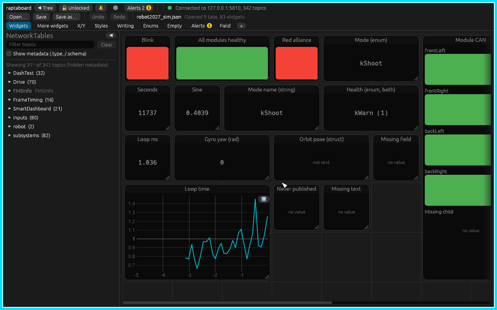
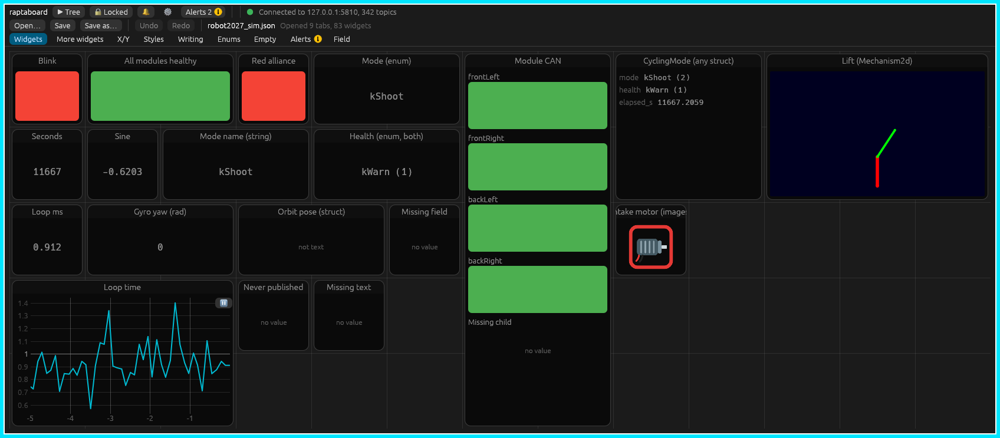

# The window

From the top:

1. **The settings bar**: the tree and lock buttons, the bell, ⚙ Settings, the alert history and
   the connection's status.
2. **The file bar**: open and save layouts, undo and redo, and the layout's name.
3. **The tab bar**: one tab per page of widgets.
4. **The NetworkTables tree**, on the left, when it's shown.
5. **The grid**, where the widgets are.

## The settings bar

| Button | What it does |
| --- | --- |
| **◀ Tree** / **▶ Tree** | Hides or shows the NetworkTables tree. |
| **🔓 Unlocked** / **🔒 Locked** | Locked, nothing on the grid or the tab bar moves or changes by accident: lock it for driving. Unlocked, widgets and tabs can be added, moved, resized and edited. Widgets that send values (toggles, sliders, choosers) work either way. |
| **🔔** / **🔕** | Sounds on or off: the tone when a value can't be sent, the Alerts widget's and FMSInfo's sounds, and plugins' sound. |
| **⚙** | Settings: the robot connection, sound, the robot's state on the window's border, content packs, and About and licenses. |
| **Alerts** | Shows or hides the alert history: every alert the robot raised since connecting. With alerts active, it shows how many and the worst one's sign. |

Then the connection's status: see [Connecting to the robot](connecting.md).

## The file bar

**Open…**, **Save** and **Save as…** open and save layout files (Elastic's JSON layouts open
too). Next come **Undo** and **Redo** for changes to the layout, then the layout file's name, with
an orange dot when it has unsaved changes, and the last thing that happened ("Saved", "Opened 7
tabs, 75 widgets"). If an opened file had values raptaboard couldn't show, a **⚠ fixed N
problems** note lists what it changed: hover to read it, right-click to copy it.

## Tabs

Click a tab to show it, or use Ctrl+1 to Ctrl+9. A tab with a widget that has something to say,
such as an Alerts widget with an error, shows its sign beside the name, so you see it from the
other tabs.

Unlocked, a tab can be changed:

- **Rename** it by double-clicking, or right-click → Rename.
- **Move** it by dragging it along the bar, or right-click → Move left, Move right.
- **Close** it with right-click → Close.
- **Add** one with the **+** after the last tab.

## The tree

The tree lists every topic the server has, in folders, with their values for the folders you
open. **Filter topics** narrows it to names containing what you type; **Show metadata** also lists
the topics that describe others (`.type`, `.schema`). WPILib structs show their fields.

Drag a topic onto the grid to make a widget for it, or right-click it for **Add to grid**, **Add
as** (any widget type that can show it) and **Add to list**. [Widgets](widgets.md) has the rest.

## The grid

Widgets sit on a grid of squares (128 pixels each unless the layout sets another size, as in
Elastic). Unlocked, each widget has a resize corner, and when the layout is bigger than the window
the scroll bars and the mouse wheel move around it. Locked, the grid stays where it is, with no
scroll bars, so a stray swipe on a touchscreen can't move it.

Locked, the window is as a driver sees it:

## The robot's state

The window's border can show the robot's state from any tab: a color for autonomous, teleop, test,
e-stop and no robot (disabled has none unless you pick one), a red flash for 3 s when the robot is
disabled, and a pop-up over the whole window when it's e-stopped. Set them in ⚙ Settings, under
**Robot state**. They're kept in the layout file, so save the layout to keep them.

## Keyboard shortcuts

Ctrl is Cmd on macOS.

| Keys | Action |
| --- | --- |
| Ctrl+O, Ctrl+S, Ctrl+Shift+S | Open, save, save as |
| Ctrl+Z, Ctrl+Shift+Z | Undo, redo (unlocked) |
| Ctrl+1 to Ctrl+9 | Show tab 1 to 9 |
| Ctrl+Left, Ctrl+Right | Previous, next tab |
| Ctrl+Tab, Ctrl+Shift+Tab | Next, previous tab (Windows and Linux) |
| Enter | Edit the selected widget's settings (unlocked) |
| Ctrl+D | Duplicate the selected widget (unlocked) |
| Delete | Delete the selected widget (unlocked) |
| Escape | Deselect |
