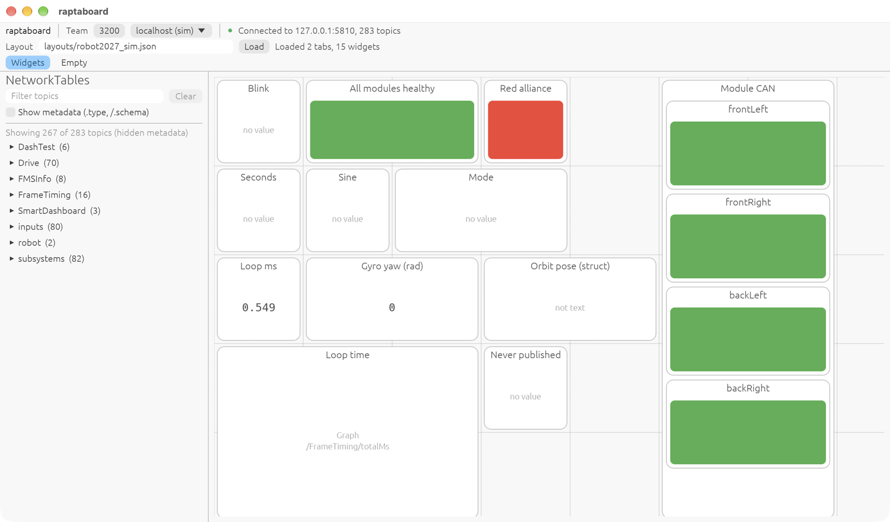
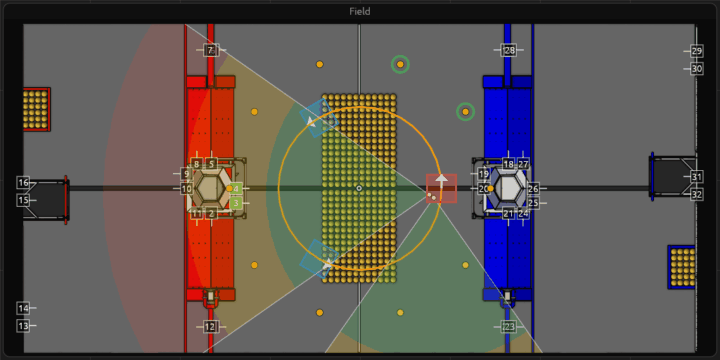

# raptaboard

raptaboard is an FRC driver dashboard written in Rust, from FRC Team 3200 (Raptacon). It started
from [Elastic](https://github.com/Gold872/elastic-dashboard) and aims past it: everything Elastic
does, a richer set of widget settings, and **widget plugins**: small WebAssembly programs that load
without rebuilding the dashboard and draw a NetworkTables table, such as an arm subsystem, or fill
a whole tab.

It opens and saves Elastic layouts, with tabs, a snap grid, List Layouts, undo and a lock for
driving. It connects to the robot over NetworkTables (by team number, the Driver Station,
SystemCore or the sim) and shows a live tree of every topic, WPILib structs included; drag a topic
onto the grid to make a widget. Widgets: Text Display, Boolean Box, Number Bar, Voltage View,
Radial Gauge, Battery, Graph, Match Time, Single and Multi Color View, Toggle Switch and Button,
Number Slider, Dropdown and Split Button Chooser, Enum Dropdown and Toggle, Field, Gyro, Swerve,
Chassis Speeds, 3D Pose, Mechanism2d, Struct, Alerts (with an alert history) and FMSInfo (the
robot's state and the match, with a sound for each change of state). Content packs add sounds and
plugins, downloaded only when you choose.

## The Field widget

The Field widget draws the robot on the field from a Pose2d (or a Field2d table), with layers from
other topics: other robots, paths, the AprilTags the cameras see, and game pieces on the field or
seen from the robot. Cameras' views and parts such as an intake ride on the robot. The clip below
is the app itself, rendered headless against a scripted robot (Robot-2026's cameras and size, on
the 2026 field).

## This book

- **Using raptaboard**: installing it, connecting, the window, widgets, layouts and content packs.
- **Developing raptaboard**: building it, how the code is laid out, and adding a built-in widget.
- **Writing plugins**: widgets and tabs of your own, in your own repository, shared in a content
  pack.

Pages not written yet are listed in grey. What changed in each release is in the
[changelog](https://github.com/tuffinmuffin/raptaboard/blob/main/CHANGELOG.md).
